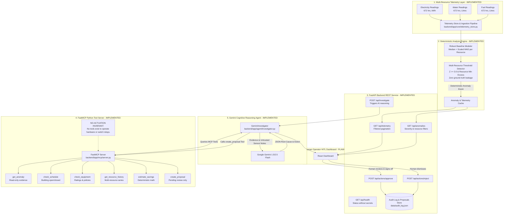

# ResourceShift AI - System Architecture

> **Architecture Status**:  
> - **Implemented & Tested**: Multi-Resource Telemetry (Electricity, Water, Fuel), Deterministic Anomaly Detection, FastAPI REST Endpoints, FastMCP Python Tool Server, Local Audit Trail, Gemini AI Reasoning & Investigation Workflow (`POST /api/investigate`).  
> - **Planned**: React Operator Dashboard, Firebase Firestore Sync, Cloud Run Container Deployment.

---

## 1. High-Level Data Flow

---

## 2. Layer Details

### Layer 1 & 2: Multi-Resource Telemetry & Deterministic Engine (`IMPLEMENTED`)
- **Supported Resources**: Electricity (`kWh`), Water (`L`), and Fuel (`L`).
- **Baseline Algorithm**: Groups by `(is_weekend, hour_of_day)`. Computes group medians and Median Absolute Deviation ($\hat{\sigma} = \max(\text{floor}, 1.4826 \times \text{MAD})$).
- **Trigger Invariants**: Requires after-hours status, $Z \ge 3.0$, and physical volume floor ($\ge 28\text{ kWh}$, $\ge 100\text{ L}$, $\ge 10\text{ L}$).
- **Evaluation**: 106 total anomalies detected across 2,016 hourly readings with $100\%$ precision, $100\%$ recall, and $0\%$ false positive rate.

### Layer 3: FastAPI Backend Application (`IMPLEMENTED`)
- `GET /api/health`: Provides service version and resource capabilities without exposing environment secrets.
- `GET /api/telemetry`: Multi-resource time-series with resource type, timestamp, building, and pagination filters.
- `GET /api/anomalies`: Active detected anomalies filtered by resource and severity.
- `POST /api/actions/approve`: Immutably records human facility manager approval with operator attribution and timestamp.
- `POST /api/actions/reject`: Records rejection decision with mandatory reason.
- `POST /api/investigate`: Triggers the Gemini AI investigation workflow for an anomaly ID.

### Layer 4: Model Context Protocol (MCP) Server (`IMPLEMENTED`)
Built using the official Python MCP SDK with backward-compatible FastMCP / MCPServer support:
1. `get_anomaly`: Detailed evidence payload for a detected anomaly ID.
2. `check_schedule`: Operating hours and academic calendar evaluation.
3. `check_equipment`: Subsystem ratings, normal operating hours, and after-hours curtailment policies.
4. `get_resource_history`: Multi-resource historical telemetry.
5. `estimate_savings`: Deterministic kWh/Litres, utility cost, and carbon abatement projections.
6. `create_proposal`: Advisory shift registration with strict `is_actuated: false` and `requires_human_approval: true`.

### Layer 5: Gemini AI Reasoning Layer (`IMPLEMENTED`)
- **SDK**: Official Google GenAI SDK (`google-genai` / `google-generativeai`).
- **Model**: Supported `gemini-1.5-flash` or `gemini-2.5-flash` configured via `GEMINI_MODEL`.
- **Workflow**:
  1. Gathers deterministic evidence via FastMCP tools (`get_anomaly`, `check_schedule`, `check_equipment`).
  2. Isolates untrusted equipment notes inside `<untrusted_sensor_notes>` tags.
  3. Prompts Gemini to diagnose likely root cause, summarize evidence, and formulate recommended action.
  4. Preserves deterministic Python savings (Gemini does not hallucinate math).
  5. Registers an advisory recommendation via MCP `create_proposal` tool for human review.
  6. Returns structured `InvestigationResult`.

---

## 3. Technology Map & Implementation Status

| Component | Technology | Implementation Status | Test Coverage |
| :--- | :--- | :--- | :--- |
| **Electricity Engine** | Python 3.11 / Pandas / NumPy | **IMPLEMENTED** | 21 passing pytest cases |
| **Water & Fuel Engine** | Python 3.11 / Pandas / NumPy | **IMPLEMENTED** | 6 passing pytest cases |
| **Savings & Impact Estimator** | Python 3.11 (Multi-Resource) | **IMPLEMENTED** | Passing pytest cases |
| **FastAPI REST Endpoints** | FastAPI / Pydantic v2 / Uvicorn | **IMPLEMENTED** | 8 passing pytest cases |
| **Local Audit Trail Store** | Python / JSON File Store | **IMPLEMENTED** | Passing pytest cases |
| **FastMCP Tool Server** | Python MCP SDK (6 Tools) | **IMPLEMENTED** | 8 passing pytest cases |
| **Gemini AI Reasoning Engine** | Google GenAI SDK (`google-genai`) | **IMPLEMENTED** | 6 passing pytest cases |
| **React HITL Dashboard** | React 18 / Vite / Tailwind CSS | `PLANNED` | — |
| **Database Persistence** | Firebase Firestore | `PLANNED` | — |
| **Cloud Hosting** | Google Cloud Run | `PLANNED` | — |
